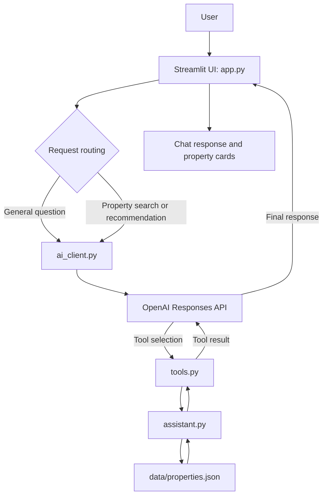

# AI Real Estate Assistant

**Emily** is a bilingual AI-powered real estate assistant built as a portfolio project to demonstrate practical skills in Python, Prompt Engineering, OpenAI API integration, and Function Calling.

The application uses a small local dataset of fictional US property listings. It is an educational demo, not a commercial real estate service.

## Features

- Bilingual interface: Russian and English.
- Streamlit chat interface and property cards.
- OpenAI Responses API using `gpt-4.1-mini`.
- System prompting with clear role and response constraints.
- Function Calling with two Python tools:
  - `search_properties`
  - `recommend_properties`
- Local property search and recommendation logic.
- Conversation history.
- Automated tests using pytest.

## Technology Stack

Python, Streamlit, OpenAI Responses API, OpenAI Python SDK, Function Calling, JSON, pytest, Git and GitHub.

## Architecture




The application handles basic request routing and property criteria locally. For property searches and recommendations, the OpenAI model selects a Python function. The application executes it against the local dataset, and the model uses the returned results to compose its response.


## Project Structure


- `app.py`: Streamlit application and user interface.

- `ai_client.py`: OpenAI Responses API integration.

- `assistant.py`: property search and recommendation logic.

- `tools.py`: Function Calling definitions and execution.

- `data/properties.json`: fictional property dataset.

- `tests/`: automated tests for the application.

- `requirements.txt`: project dependencies.

- `.gitignore`: files excluded from Git.

## Getting Started


1. Clone the repository:


```bash

git clone https://github.com/Ivan-Pankov/ai-real-estate-assistant.git

cd ai-real-estate-assistant

```


2. Create and activate a virtual environment:


```bash

python3 -m venv .venv

source .venv/bin/activate

```


3. Install dependencies:


```bash

pip install -r requirements.txt

```


4. Create a `.env` file in the project root:


```env

OPENAI_API_KEY=your_api_key_here

```


Use your own API key. Never commit `.env` to Git.


5. Start the application:


```bash

streamlit run app.py

```


Open the local URL shown in the terminal, usually `http://localhost:8501`.

## Running Tests


Run the automated test suite:


```bash

python -m pytest -q

```


The project currently includes 13 tests covering property search, recommendation logic, Function Calling tools, input validation, and OpenAI client behavior. Tests use controlled inputs and do not require live API calls.


## Related Machine Learning Project


A separate project demonstrates US real estate price prediction:


[DataScience_SF: US Real Estate Price Prediction](https://github.com/Ivan-Pankov/DataScience_SF/tree/master/Project_8_Final)


It covers data preprocessing, exploratory data analysis, feature engineering, and regression modeling on approximately 377,000 US property records. Its README reports an R² score of approximately 0.69 for the selected Gradient Boosting model.


This is a separate project and is not integrated into Emily.


## Limitations


- Property listings and prices are fictional demonstration data.

- The application does not retrieve live property listings.

- Search results are limited to the local JSON dataset.

- AI-generated explanations are not financial, legal, or real estate advice.

- OpenAI API usage requires a valid API key and may incur charges.


## Project Status


Educational portfolio project demonstrating the integration of a language model with Python application logic and structured tools.
